<p align="center">
  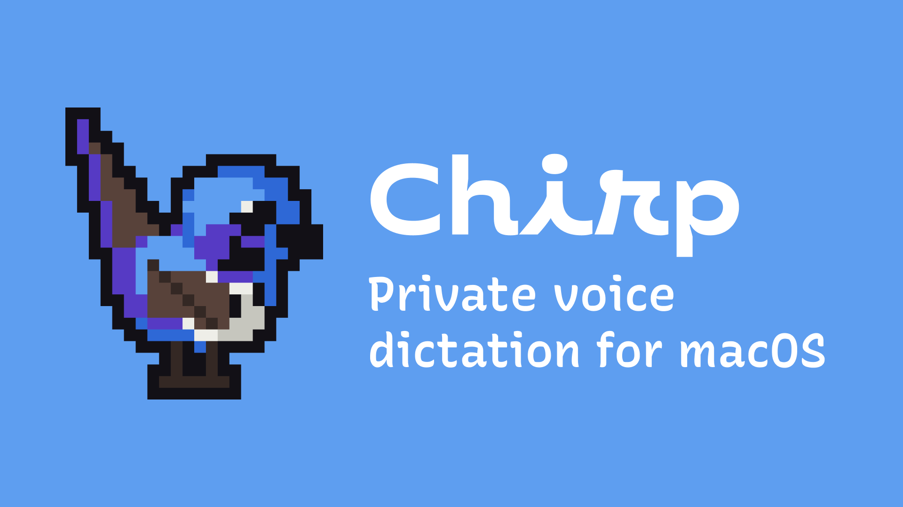
</p>

**Private voice dictation for Mac.**

Hold your dictation key, speak, release. Chirp pastes the transcript at
your cursor. Recognition and cleanup run on your Mac, with no account,
subscription, or word limits.

## Install

1. Download **Chirp-<version>.dmg** from the
   [latest release](https://github.com/jaclyntan/chirp/releases/latest).
2. Open the disk image and drag **Chirp** into **Applications**.
3. Open Chirp and follow the welcome guide to choose a dictation key and
   test your microphone.

Chirp is self-signed and isn't notarised, so macOS may block the first
launch. If that happens, open **System Settings → Privacy & Security**
and look for **Open Anyway** after trying to open the app. Only bypass
that warning for a copy you downloaded from this repository's releases.

Allow **Microphone** access to record and **Accessibility** access for
global shortcuts and automatic pasting. Without Accessibility, you can
paste the copied transcript yourself with **⌘V**. Notetaker also needs
**Screen Recording** access to capture a meeting app's audio.

Chirp lives in the menu bar and has no Dock icon. Click its menu-bar icon
or the floating bird to open the main window.

### Requirements

- Apple silicon Mac (M1 or later).
- macOS 26 (Tahoe) or later.
- Internet access for any required first-use model downloads. Once the
  models are installed, transcription works offline.
- Optional meeting summaries require Apple Intelligence to be available
  and enabled on your Mac.

## What it does

- **Push-to-talk:** hold `fn` (Globe), speak, and release to paste. You can
  choose Right Option, Right Command, Right Control, or Right Shift instead.
  Double-tap for hands-free recording; tap again to stop.
- **On-device recognition:** uses Apple's SpeechAnalyzer. macOS downloads
  the selected language's speech assets if they aren't already installed.
- **Text cleanup:** removes fillers, recognises spoken “new line” and
  “new paragraph”, and applies your dictionary and saved snippets.
  [Harper](https://github.com/Automattic/harper) handles English spelling
  and grammar without a language-model rewrite.
- **Terminal defaults:** skips formatting and grammar cleanup in recognised
  terminals. Learned English corrections and snippets still apply. Code
  editors use the normal cleanup pipeline.
- **Personal corrections:** edit a transcript in History to teach Chirp a
  misheard word. Starter snippets and dictionary entries can be edited or
  cleared.
- **Paste last transcript:** an optional shortcut pastes your most recent
  transcript again wherever the cursor is now.
- **Live transcript:** optionally shows words in the bird's speech bubble
  while you dictate from its toolbar. Off by default; downloads a separate
  streaming model on first use.
- **Notetaker:** records your mic and a meeting app's audio, separates
  speakers, and saves a local transcript. You can request an on-device
  summary for each note. Meeting live captions are off by default.
- **Launch at login:** optional, in Settings.

## The wren

<p align="center">
  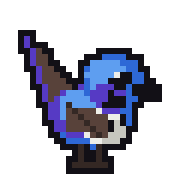
  
  
  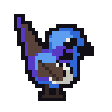
  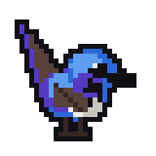
  <br>
  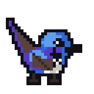
  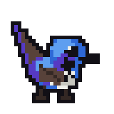
  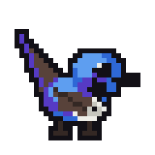
  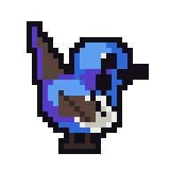
  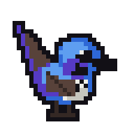
  <br>
  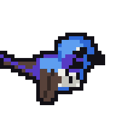
  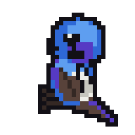
  
  
  
</p>

The mascot is a splendid fairy-wren, drawn as transparent 32×32 pixel art.
It listens while you record, tilts its head while processing, and preens,
blinks, or flicks its tail while resting. Click it to open Chirp, or use
its toolbar to dictate and read the result in a speech bubble.

Turn on wandering to let it hop and fly around your screen, or pin it in
place. Idle animations pause when hidden, in Low Power Mode, or under
thermal pressure.

All 15 updated animations are shown above. Sleeping, side-perching, and
celebration are included in the asset set for future interactions; the
app doesn't trigger those three yet. See the
[animation notes](Resources/Pet/README.md) for states and timing.

## Privacy

Audio, transcripts, and cleanup stay on your Mac. Dictation uses Apple's
on-device speech engine; formatting, personal corrections, snippets, and
Harper run locally. Optional meeting summaries use Apple Intelligence
on-device.

Network access is used to check GitHub for updates and to download missing
models: Apple's speech assets, speech-detection models, the optional live
transcript model, and meeting speaker-separation models. Audio isn't sent
to a transcription service.

Chirp stores history, notes, and personal dictionaries in
`~/Library/Application Support/Chirp/`. Preferences use the `local.chirp`
UserDefaults domain.

## Building from source

Requires full Xcode with Swift 6.2 or later, rather than only Command Line
Tools.

```bash
git clone https://github.com/jaclyntan/chirp.git
cd chirp
./scripts/make_signing_cert.sh   # once, to keep permissions across rebuilds
./scripts/make_app.sh            # builds and signs build/Chirp.app
open build/Chirp.app
```

The app uses SwiftUI and AppKit in a Swift package. Harper ships as a
vendored xcframework; FluidAudio supplies speech detection, live preview,
and meeting speaker separation. Third-party licences are in
[NOTICE.md](NOTICE.md).

```text
HotkeyMonitor → AudioRecorder → Transcriber (Apple SpeechAnalyzer)
                                        ↓
        TextFormatter → LearnedStore → SnippetStore → HarperChecker
                                        ↓
                        TextInserter (clipboard + ⌘V)
```

The cleanup path varies by language and target app, as described above.

- [Build, test, and architecture notes](CLAUDE.md)
- [Changelog](CHANGELOG.md)
- [Performance notes](docs/performance.md)
- [Previously trialled recognition engines](docs/removed-engines.md)

## Credits and licence

Chirp began as a fork of
[Murmur](https://github.com/janisbelozerovs-dev/murmur). Its interface and
recognition pipeline have since changed substantially. Thanks to the
Murmur authors for the foundation; their copyright notice is retained in
[LICENSE](LICENSE).

[MIT](LICENSE). Not affiliated with Apple.
